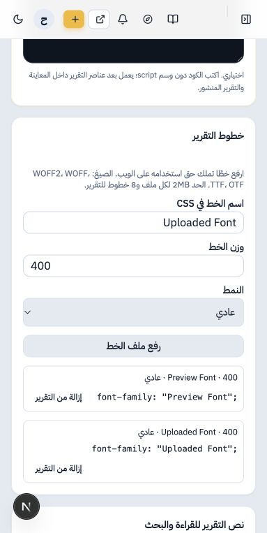

# تطوير تقارير «جاك العلم» — أدلة المراجعة

تاريخ التحقق: 18 أكتوبر 2026. البيئة: محلية معزولة، بقاعدة PostgreSQL 17 وحسابات ومخزن ملفات تجريبية. لم تُستخدم بيانات الإنتاج في الاختبارات ولم تُعدّل صلاحيات مستخدمي الموقع.

## ما تغير

| الطلب | النتيجة |
|---|---|
| خانة JavaScript مستقلة | أُضيفت إلى المحرر والحفظ والمعاينة والعرض المنشور؛ تعمل بعد عناصر التقرير. بقي دعم السكربتات القديمة داخل HTML. |
| خطوط خاصة لكل تقرير | رفع WOFF2 وWOFF وTTF وOTF، ثم استخدامها باسمها في CSS. الحد 2MB للملف و8 تعريفات خط للتقرير. |
| تقييد التحرير بالدور | بوابة `jak.manage` الحالية مع صلاحيات تحرير المواد المملوكة أو جميع المواد. إزالة هذه الصلاحية من دور تمنعه من واجهات إدارة جاك. |
| النشر المباشر | صلاحية مستقلة `jak.publish` تسمح بالنشر من المسودة دون مرحلة اعتماد منفصلة، وتلزم لتعديل تقرير منشور. |
| الأرشفة والاستعادة | صلاحيتان مستقلتان `jak.archive` و`jak.restore`. |
| الحذف النهائي | صلاحية `jak.delete`، مع أرشفة التقرير أولًا وكتابة عنوانه للتأكيد والتحقق من نسخته؛ يسجل الحذف في سجل العمليات. |
| الوصول إلى النص من البحث | نص التقرير موجود في HTML الصفحة الرئيسية له، تحت «قراءة نص التقرير»، ويمكن للقارئ فتحه. العرض التفاعلي ما زال داخل إطار معزول. |

## ضبط الدور عند التفعيل

من شاشة الأدوار الحالية، يخصص مسؤول النظام الدور المناسب لفريق جاك:

- `jak.manage` للدخول إلى إدارة التقارير.
- `story.create` للإنشاء، و`story.edit.own` أو `story.edit.any` بحسب نطاق التحرير المطلوب.
- `jak.publish` للنشر المباشر وتحديث المنشور.
- `jak.archive` و`jak.restore` للأرشفة والاستعادة.
- `jak.delete` فقط لمن يسمح له بالحذف النهائي.

يجب إزالة `jak.manage` من الأدوار الأخرى إذا كان المطلوب منعها من تحرير تقارير جاك. هذه خطوة إعداد لاحقة؛ لا يتضمن PR تغيير تعيينات المستخدمين الفعلية. مسؤول النظام يبقى صاحب الصلاحيات الشاملة وفق السياسة الموجودة بالمشروع.

## النص والـiframe

الهدف المتعلق بالبحث عولج بإتاحة نسخة نصية في الصفحة نفسها، دون تشغيل أكواد التقرير في نطاق لوحة التحكم أو صفحة الموقع المحيطة. الإطار التفاعلي يحتفظ بقيود العزل وغياب `allow-same-origin` ومنع الاتصالات والنماذج في CSP.

يستخرج الخادم النص من HTML دون تشغيل JavaScript أو جلب موارد. ويستطيع الفريق إدخال النص الكامل المطابق للتقرير في خانة مستقلة عندما تكون الكلمات داخل صور أو مولّدة بالحركة. الاستخراج لا يقرأ الصور ولا يطبق جميع قواعد CSS الخارجية؛ يلزم مراجعة النص في هذه الحالات. لا يتضمن هذا التحقق ادعاء اكتمال فهرسة Google.

## التحقق المنفذ

| الفحص | النتيجة |
|---|---|
| بوابة `npm test` | نجاح lint وTypeScript وبناء الإنتاج و506 اختبارات وميزانية JavaScript في نسخة نظيفة معزولة. |
| `tests/jak-controls.test.mjs` | تشغيل السكربت بعد المحتوى حتى مع وجود `</body>` داخل سكربت قديم؛ سلامة تعريفات الخطوط؛ كشف الملفات؛ استخراج النص؛ وحدود حجم الطلب ومصدره. |
| `tests/jak-reports.integration.mjs` | نجاح حفظ الحقول الجديدة وحماية الحفظ من محرر قديم، ومنع نشر جاك بصلاحية نشر الأخبار وحدها، والنشر المباشر، ورفض تعديل المنشور دون صلاحية، والحذف وضوابطه وسجله. |
| `tests/migration-adoption.integration.mjs` | ترقية المخطط وإعادة تشغيلها دون تكرار، مع الحفاظ على البيانات السابقة. |
| `tests/permission-matrix.integration.mjs` | نجاح فحوص الصلاحيات والجلسات والمصادقة الإضافية: 17 مسارًا × 3 حالات جلسة، مع بقية فحوص المصفوفة. |
| `tests/canonical-redirects.integration.mjs` | نجاح تحويلات وروابط جاك العددية والقديمة وCanonical وباقي اختبارات الروابط. |
| تجربة متصفح على بيانات اصطناعية | تسجيل الدخول، حفظ JS ونص القراءة، رفع خط إلى مخزن تجريبي وحفظه، وعرض التقرير. زر JavaScript غيّر العداد من 0 إلى 42، ومحاولة قراءة الصفحة المحيطة رُفضت. |

التحقق من الخط شمل استجابة HTTP 200 و`font/woff2` وCORS المخصص للعرض المعزول. لم يُرفع خط إلى مخزن الإنتاج. التحذيرات السابقة الخاصة بـ`brand-mark` و`staleTimes.static` ليست أخطاء في هذه الإضافة. نواتج معاينة مؤقتة تداخلت مع أول إعادة للفحص؛ أزيلت وأعيد الفحص في نسخة نظيفة بنجاح.

نتيجة GitHub CI النهائية تظهر في PR. اختبارات الدخول الفعلية للفريق والنشر على Railway لم تنفذ ضمن هذه المرحلة.

## ترتيب النشر والتراجع

1. مراجعة PR ونجاح CI، ثم تجهيز نقطة استعادة لقاعدة البيانات قبل الترقية.
2. تطبيق ترقية `0024_jak_report_controls.sql` بالطريقة المعتمدة بالمشروع **قبل تشغيل نسخة التطبيق الجديدة**؛ تشغيل التطبيق وحده لا يطبقها تلقائيًا. تستخدم أداة المشروع `node scripts/migrate-db.mjs --apply` اتصالًا مباشرًا آمنًا بعد مراجعة حالة سجل الترقيات.
3. نشر نسخة التطبيق، ثم ضبط الدور واختبار تقرير تجريبي بحساب الفريق وحساب غير مخول.
4. فحص حفظ JS والخط والمعاينة والنشر والأرشفة، والتأكد من عرض النص وروابط التقارير القديمة.

الترقية إضافية: أعمدة جديدة بقيم افتراضية فارغة، ونسخ صلاحيات النشر والأرشفة والاستعادة السابقة إلى مفاتيح جاك، بما فيها الاستثناءات الفردية المانعة. لا تمنح صلاحية الحذف النهائي تلقائيًا. تستخدم الخطوط مخزن الملفات الحالي تحت بادئة `jak-fonts/` دون تغيير أسرار أو إعدادات الاستضافة.

للتراجع عن الكود يمكن إعادة الإصدار السابق وترك الأعمدة الجديدة والملفات كما هي. إعادة الكود السابق لا تستعيد تقريرًا حُذف نهائيًا؛ استرجاعه يحتاج النسخة الاحتياطية. ملفات الخطوط والصور المشتركة لا تحذف مع التقرير حتى لا تتعطل تقارير أخرى. الملفات المرفوعة التي لم تُربط بتقرير تبقى في المخزن، ولا يتضمن هذا PR مهمة تنظيف تلقائية.

## لقطة من بيئة الاختبار

واجهة الخطوط الجديدة على الجوال؛ جميع الأسماء والمحتويات الظاهرة تجريبية:

